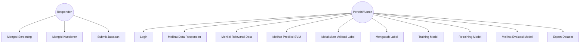
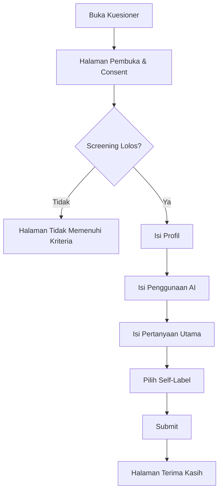
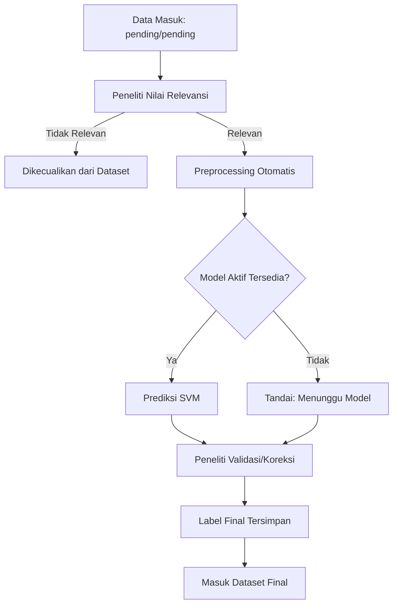
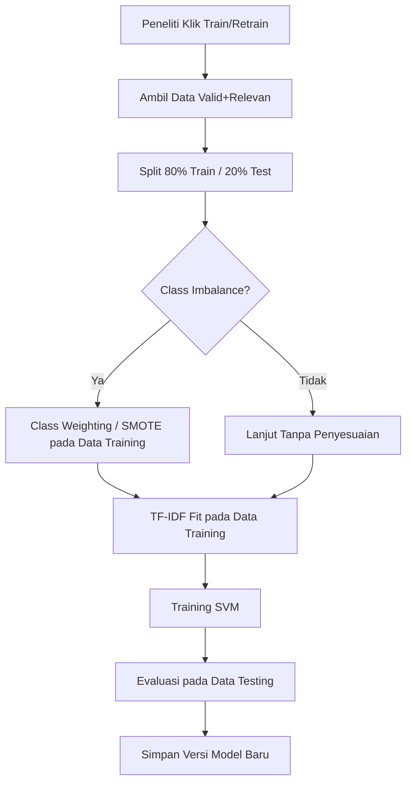
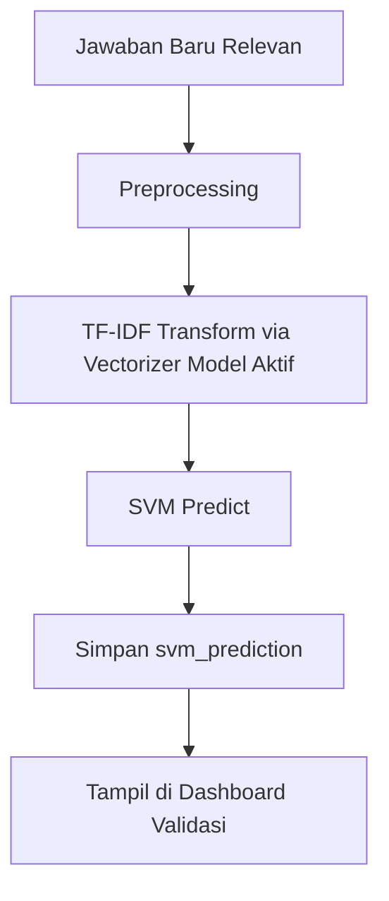
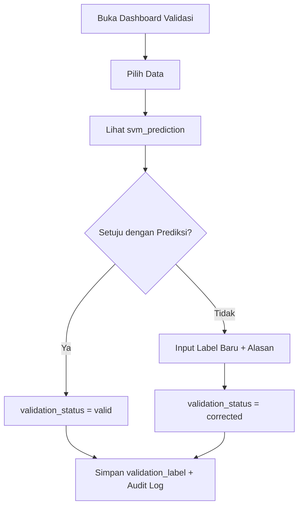
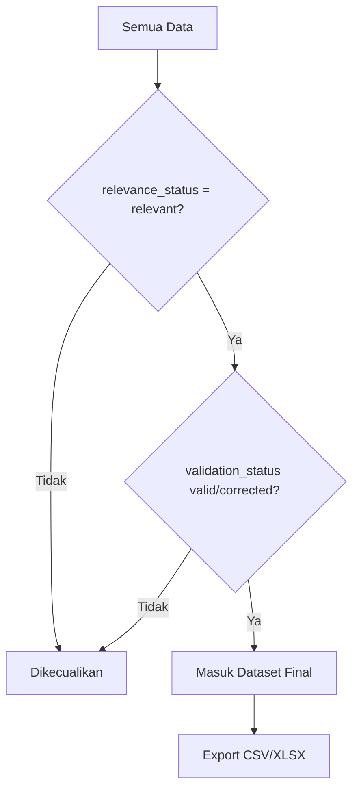
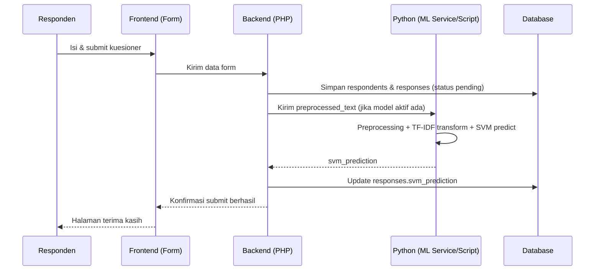
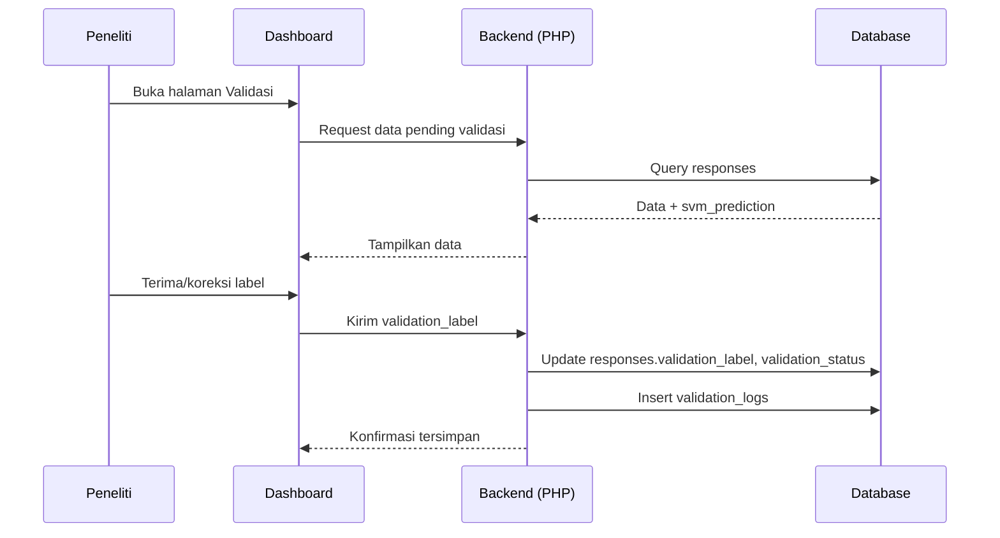
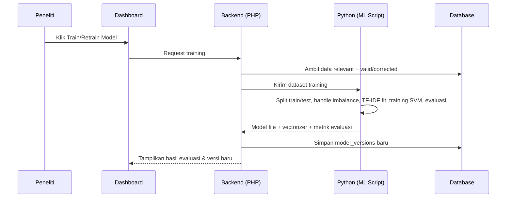

# Product Requirements Document (PRD)
## Sistem Pendukung Penelitian: Klasifikasi Sentimen Dampak Artificial Intelligence terhadap Produktivitas dalam Aktivitas Pemrograman Mahasiswa Teknik Informatika Universitas Pamulang Menggunakan Support Vector Machine

**Versi Dokumen:** 1.0
**Judul Skripsi (Disetujui):** Klasifikasi Sentimen terhadap Dampak Artificial Intelligence pada Produktivitas dalam Aktivitas Pemrograman pada Mahasiswa Teknik Informatika Universitas Pamulang Menggunakan Support Vector Machine

---

## 1. Product Overview

Sistem ini adalah **alat bantu penelitian (research support tool)**, bukan aplikasi produktivitas, bukan chatbot, dan bukan AI assistant. Sistem digunakan oleh satu peneliti (mahasiswa penyusun skripsi) untuk mengelola seluruh siklus pengumpulan data penelitian: mulai dari kuesioner responden, screening, penilaian relevansi, klasifikasi sentimen otomatis menggunakan TF-IDF + Support Vector Machine (SVM), validasi manual oleh peneliti, hingga penyusunan dataset final dan evaluasi performa model.

Sistem terdiri dari dua bagian utama:
1. **Aplikasi web publik** — form kuesioner untuk responden (mahasiswa aktif Teknik Informatika UNPAM).
2. **Dashboard peneliti/admin** — untuk mengelola data, memvalidasi label, melatih model SVM, mengevaluasi performa, dan mengekspor dataset final.

## 2. Background

Penggunaan Artificial Intelligence (ChatGPT, GitHub Copilot, Gemini, Claude, dll.) dalam aktivitas pemrograman mahasiswa semakin umum. Dampaknya terhadap produktivitas dapat bersifat positif (mempercepat coding, membantu debugging) maupun negatif (ketergantungan, menurunnya kemampuan berpikir mandiri). Untuk menganalisis kecenderungan opini mahasiswa terhadap dampak ini secara sistematis, penelitian ini mengumpulkan opini mahasiswa melalui kuesioner terbuka, kemudian mengklasifikasikan sentimen opini tersebut (Positif/Negatif/Netral) menggunakan pendekatan machine learning (TF-IDF + SVM), dengan validasi manual oleh peneliti sebagai penentu label akhir.

## 3. Problem Statement

Peneliti membutuhkan cara yang terstruktur untuk:
- Mengumpulkan data opini mahasiswa secara valid (lolos screening, relevan, bukan spam).
- Mengklasifikasikan sentimen opini secara otomatis sebagai titik awal, tanpa mengorbankan validitas ilmiah (karena model ML tidak boleh dijadikan ground truth mutlak).
- Melacak perbedaan antara self-label responden, prediksi model, dan label final hasil validasi peneliti — agar proses penelitian transparan dan dapat dipertanggungjawabkan secara akademis.
- Menghasilkan dataset final yang bersih dan siap dipakai untuk pelaporan skripsi, lengkap dengan evaluasi performa model.

Tanpa sistem ini, proses di atas akan sangat memakan waktu jika dilakukan manual (misalnya di spreadsheet), rawan human error, dan sulit ditelusuri jejak perubahan labelnya.

## 4. Research Objectives

1. Mengumpulkan ±300–500 data opini mahasiswa TI UNPAM yang telah lolos screening dan valid untuk digunakan sebagai data penelitian.
2. Mengklasifikasikan opini ke dalam tiga kelas sentimen: Positif, Negatif, Netral, menggunakan TF-IDF + SVM.
3. Memvalidasi hasil klasifikasi otomatis dengan penilaian manual peneliti sebagai penentu label final.
4. Mengevaluasi performa model SVM (accuracy, precision, recall, F1-score, confusion matrix) secara multiclass.
5. Menghasilkan dataset penelitian final yang dapat diekspor untuk kebutuhan analisis dan pelaporan skripsi.

## 5. Product Goals

- Memisahkan dengan jelas antara data mentah, prediksi model, dan label final.
- Menjaga peran peneliti sebagai validator akhir (human-in-the-loop), bukan sekadar operator sistem otomatis.
- Menyediakan dashboard yang sederhana, cepat digunakan, dan cukup untuk kebutuhan skripsi (tidak over-engineered).
- Menjamin ketertelusuran (traceability) setiap perubahan label melalui audit log.

## 6. Target Users

| Peran | Deskripsi |
|---|---|
| Responden | Mahasiswa aktif Program Studi Teknik Informatika UNPAM yang pernah menggunakan AI untuk aktivitas pemrograman. Mengisi kuesioner satu kali. |
| Peneliti/Admin | Mahasiswa penyusun skripsi (Dav). Mengelola seluruh data, validasi label, training model, evaluasi, dan ekspor dataset. |

## 7. Scope

Sistem mencakup:
- Form kuesioner responden dengan screening bertingkat.
- Penyimpanan data responden dan jawaban ke database.
- Modul preprocessing teks Bahasa Indonesia.
- Modul klasifikasi sentimen berbasis TF-IDF + SVM (training, retraining, prediksi).
- Dashboard peneliti: overview statistik, manajemen data, validasi label, evaluasi model, ekspor dataset.
- Audit log perubahan label.
- Role-based access (Responden vs Peneliti/Admin).

## 8. Out of Scope

- Mengukur produktivitas secara objektif (misalnya lewat waktu coding aktual).
- Membandingkan performa berbagai tools AI satu sama lain.
- Membangun AI/model bahasa baru.
- Chatbot atau AI assistant apa pun di dalam sistem.
- Aplikasi coding assistant.
- Menjadikan self-label responden sebagai ground truth otomatis.
- Fitur sosial, gamifikasi, animasi berlebihan, atau fitur yang tidak menunjang penelitian.

## 9. User Roles

### 9.1 Responden
- Mengisi kuesioner (screening → profil → penggunaan AI → jawaban utama → self-label → submit).
- Tidak bisa melihat data responden lain.
- Tidak bisa mengubah data setelah submit.
- Tidak memerlukan akun/login (pengisian anonim per sesi, kecuali NEED DECISION di bawah).

### 9.2 Peneliti/Admin
- Login ke dashboard dengan akun admin.
- Melihat seluruh data responden dan jawaban.
- Menilai relevansi jawaban.
- Melihat prediksi SVM dan melakukan validasi/koreksi label.
- Melatih dan melatih ulang (retrain) model.
- Melihat hasil evaluasi model.
- Mengekspor dataset final (CSV/XLSX).

**KEPUTUSAN IDENTITAS (Resolved):** Responden anonim penuh. Pencegahan duplikasi dilakukan di tahap validasi relevansi secara manual oleh peneliti. Di sisi frontend, dipasang sistem pencegah *double submit* menggunakan LocalStorage/Cookie yang menyembunyikan/memblokir form jika sebelumnya sudah disubmit.

## 10. User Journey

### 10.1 Responden
1. Membuka link kuesioner → halaman pembuka & penjelasan penelitian (consent).
2. Menjawab 2 pertanyaan screening.
3. Jika salah satu "Tidak" → ditampilkan halaman "Anda tidak memenuhi kriteria" dan form berhenti di sini.
4. Jika lolos → mengisi profil (semester, kelas).
5. Mengisi data penggunaan AI (tools, frekuensi, tujuan).
6. Menjawab pertanyaan utama (minimal 2–3 kalimat).
7. Memilih self-label (Positif/Negatif/Netral).
8. Submit → melihat halaman terima kasih.

### 10.2 Peneliti/Admin
1. Login ke dashboard.
2. Melihat overview statistik data masuk.
3. Membuka menu Data Responden → menilai relevansi jawaban baru.
4. Membuka menu Validasi → melihat prediksi SVM per jawaban, menerima/mengoreksi label.
5. Setelah data terkumpul cukup, melakukan Train/Retrain model dari menu Training.
6. Melihat hasil evaluasi model (accuracy, precision, recall, F1, confusion matrix).
7. Membuka menu Dataset → melihat data yang sudah final dan valid.
8. Melakukan Export dataset (CSV/XLSX) untuk kebutuhan analisis skripsi.

---

## 11. Functional Requirements

Format setiap requirement: **ID | Nama Fitur | Deskripsi | Aktor | Input | Process | Output | Business/Research Rule | Acceptance Criteria**

### FR-01 — Halaman Pembuka & Consent
- **Deskripsi:** Menampilkan judul penelitian, tujuan singkat, dan persetujuan sebelum mengisi kuesioner.
- **Aktor:** Responden
- **Input:** Klik "Mulai Mengisi" / persetujuan
- **Process:** Menampilkan teks penjelasan penelitian, meminta konfirmasi kesediaan
- **Output:** Responden diarahkan ke halaman screening
- **Business Rule:** Responden tidak bisa lanjut tanpa menyetujui
- **Acceptance Criteria:** Halaman tampil sebelum screening; tombol lanjut nonaktif sebelum consent dicentang (jika consent berupa checkbox)

### FR-02 — Screening Kelayakan Responden
- **Deskripsi:** Menyaring responden berdasarkan status mahasiswa aktif TI UNPAM dan pengalaman memakai AI untuk pemrograman.
- **Aktor:** Responden
- **Input:** Jawaban Ya/Tidak untuk 2 pertanyaan screening
- **Process:** Sistem mengevaluasi kombinasi jawaban
- **Output:** Lanjut ke profil (jika lolos) atau halaman penolakan (jika tidak lolos)
- **Business Rule:** Jika salah satu jawaban "Tidak", responden tidak dapat melanjutkan ke bagian mana pun setelahnya
- **Acceptance Criteria:** Jawaban "Tidak" pada pertanyaan mana pun langsung menghentikan alur; data screening tetap dicatat (untuk statistik "data tidak relevan/tidak lolos")

### FR-03 — Form Profil Responden
- **Deskripsi:** Mengumpulkan data semester dan kelas/reguler.
- **Aktor:** Responden
- **Input:** Pilihan semester (1–2/3–4/5–6/7–8/9–10), kelas (A/B/CK/CS)
- **Process:** Validasi field wajib diisi
- **Output:** Data tersimpan sementara di sesi form
- **Business Rule:** Field wajib diisi
- **Acceptance Criteria:** Form tidak bisa lanjut jika field kosong

### FR-04 — Form Penggunaan AI
- **Deskripsi:** Mengumpulkan tools AI, frekuensi, dan tujuan penggunaan.
- **Aktor:** Responden
- **Input:** Pilihan tools (multi-select), frekuensi (single-select), tujuan (multi-select)
- **Process:** Validasi field wajib
- **Output:** Data tersimpan sementara di sesi form
- **Business Rule:** Minimal satu tools dan satu tujuan harus dipilih
- **Acceptance Criteria:** Validasi mencegah submit tanpa memilih minimal satu opsi pada tiap kategori

### FR-05 — Pertanyaan Utama (Opini Terbuka)
- **Deskripsi:** Menangkap opini bebas responden mengenai dampak AI terhadap produktivitas pemrograman.
- **Aktor:** Responden
- **Input:** Teks jawaban bebas
- **Process:** Validasi panjang minimal (disarankan minimal jumlah karakter/kata sebagai proxy "2–3 kalimat")
- **Output:** Teks jawaban tersimpan
- **Business Rule:** Wajib diisi; sistem dapat menampilkan peringatan (bukan blokir mutlak) jika jawaban dirasa terlalu pendek
- **Acceptance Criteria:** Jawaban kosong tidak bisa submit; jawaban di bawah ambang batas kata memicu peringatan konfirmasi

**KEPUTUSAN VALIDASI (Resolved):** Validasi lunak (soft warning). Jika responden mengetik kurang dari 15 kata, sistem akan menampilkan pop-up konfirmasi. Jika responden memilih "Tetap Kirim", data tetap disubmit dan kualitas jawabannya disaring manual di dashboard Admin.

### FR-06 — Self-Label Responden
- **Deskripsi:** Responden memberi penilaian awal atas opininya sendiri.
- **Aktor:** Responden
- **Input:** Pilihan Positif/Negatif/Netral
- **Process:** Disimpan sebagai `self_label`, terpisah dari `svm_prediction` dan `validation_label`
- **Output:** Data self-label tersimpan
- **Business Rule:** Self-label BUKAN ground truth; tidak boleh dipakai otomatis sebagai label final
- **Acceptance Criteria:** Field `self_label` tidak pernah menimpa `validation_label` secara otomatis di database manapun

### FR-07 — Submit Kuesioner
- **Deskripsi:** Menyimpan seluruh data kuesioner ke database.
- **Aktor:** Responden
- **Input:** Seluruh data form
- **Process:** Validasi akhir semua field wajib, simpan ke tabel `respondents` dan `responses`
- **Output:** Data tersimpan, status awal `relevance_status = pending`, `validation_status = pending`
- **Business Rule:** Data tidak dapat diubah oleh responden setelah submit
- **Acceptance Criteria:** Responden lolos screening; semua field wajib terisi; jawaban utama minimal terisi; data tersimpan dengan status pending; muncul halaman terima kasih

### FR-08 — Preprocessing Teks Otomatis
- **Deskripsi:** Memproses teks jawaban mentah menjadi bentuk siap analisis.
- **Aktor:** Sistem (dipicu otomatis saat data masuk, atau manual oleh peneliti)
- **Input:** Teks jawaban mentah
- **Process:** Case folding → cleaning (hapus karakter tak relevan/URL/emoji) → tokenization → stopword removal → stemming
- **Output:** Teks hasil preprocessing tersimpan terpisah dari teks asli
- **Business Rule:** Teks asli tidak boleh ditimpa/dihapus; hasil preprocessing disimpan sebagai field/tabel terpisah agar bisa ditelusuri
- **Acceptance Criteria:** Untuk setiap jawaban tersedia versi `raw_text` dan `preprocessed_text`

### FR-09 — Prediksi Sentimen Otomatis (SVM)
- **Deskripsi:** Memberi prediksi sentimen awal terhadap jawaban baru menggunakan model SVM yang sudah dilatih.
- **Aktor:** Sistem (dipicu saat data baru masuk dan model sudah ada)
- **Input:** `preprocessed_text`
- **Process:** TF-IDF vectorization (memakai vectorizer dari model aktif) → klasifikasi SVM
- **Output:** `svm_prediction` (Positif/Negatif/Netral), disimpan dengan referensi versi model yang dipakai
- **Business Rule:** Prediksi TIDAK otomatis menjadi label final; jika belum ada model terlatih, field ini kosong/null dan ditandai "belum ada prediksi"
- **Acceptance Criteria:** Setiap jawaban baru memiliki `svm_prediction` jika model aktif tersedia; jika tidak, sistem menampilkan status "menunggu training model" pada dashboard

### FR-10 — Penilaian Relevansi Data
- **Deskripsi:** Peneliti menandai apakah suatu jawaban relevan dengan topik penelitian.
- **Aktor:** Peneliti/Admin
- **Input:** Pilihan Relevan/Tidak Relevan, opsional catatan
- **Process:** Sistem dapat menampilkan penanda "perlu ditinjau" otomatis berdasarkan keyword/panjang teks sebagai bantuan (bukan keputusan final), lalu peneliti menetapkan keputusan
- **Output:** `relevance_status` terupdate (relevant/irrelevant)
- **Business Rule:** Keyword filter hanya alat bantu penanda, keputusan akhir selalu manual oleh peneliti
- **Acceptance Criteria:** Status relevansi hanya berubah lewat aksi eksplisit peneliti; data dengan status `irrelevant` otomatis dikecualikan dari dataset final

### FR-11 — Validasi & Koreksi Label
- **Deskripsi:** Peneliti meninjau prediksi SVM dan menetapkan label final.
- **Aktor:** Peneliti/Admin
- **Input:** Keputusan menerima prediksi SVM apa adanya, atau mengganti label, plus opsional alasan koreksi
- **Process:** Jika label peneliti = `svm_prediction` → `validation_status = valid`; jika berbeda → `validation_status = corrected`; simpan `validation_label`
- **Output:** `validation_label`, `validation_status`, dan entri audit log
- **Business Rule:** Label final penelitian selalu `validation_label`, bukan `svm_prediction` maupun `self_label`
- **Acceptance Criteria:** Setiap perubahan label tercatat di audit log (label lama, label baru, siapa, kapan, alasan jika diisi)

### FR-12 — Dashboard Overview
- **Deskripsi:** Ringkasan statistik penelitian secara real-time.
- **Aktor:** Peneliti/Admin
- **Input:** — (agregasi otomatis dari data)
- **Process:** Hitung total responden, relevan/tidak relevan, tervalidasi/belum, distribusi Positif/Negatif/Netral
- **Output:** Kartu statistik + grafik distribusi sentimen
- **Business Rule:** Angka overview hanya menghitung data yang lolos screening
- **Acceptance Criteria:** Semua angka overview konsisten dengan data di tabel Data Responden pada waktu yang sama

### FR-13 — Manajemen Data Responden (Tabel + Filter)
- **Deskripsi:** Menampilkan seluruh data dalam bentuk tabel dengan kemampuan pencarian dan filter.
- **Aktor:** Peneliti/Admin
- **Input:** Kata kunci pencarian, filter (semester, kelas, sentimen, status validasi, status relevansi)
- **Process:** Query database sesuai filter
- **Output:** Tabel data responden dan jawaban
- **Business Rule:** Data responden lain tidak boleh terekspos ke publik
- **Acceptance Criteria:** Filter dapat dikombinasikan; hasil pencarian sesuai dengan kombinasi filter yang dipilih

### FR-14 — Detail Jawaban
- **Deskripsi:** Menampilkan detail lengkap satu jawaban responden.
- **Aktor:** Peneliti/Admin
- **Input:** Klik satu baris data
- **Process:** Ambil semua field terkait jawaban tersebut termasuk histori validasi
- **Output:** Halaman/panel detail: teks asli, hasil preprocessing, self-label, svm_prediction, validation_label, catatan koreksi
- **Business Rule:** —
- **Acceptance Criteria:** Semua field yang relevan tampil dalam satu tampilan tanpa perlu berpindah halaman

### FR-15 — Training Model (Manual)
- **Deskripsi:** Melatih model SVM dari data yang sudah valid dan relevan.
- **Aktor:** Peneliti/Admin
- **Input:** Klik "Train Model", opsional parameter (kernel, C, dsb.)
- **Process:** Ambil data dengan `relevance_status=relevant` dan `validation_status` valid/corrected → split train/test → TF-IDF fit → training SVM → evaluasi → simpan model baru sebagai versi baru
- **Output:** Model tersimpan (`model_versions`), hasil evaluasi ditampilkan
- **Business Rule:** Training TIDAK berjalan otomatis setiap ada 1 data baru masuk; hanya dijalankan manual oleh peneliti
- **Acceptance Criteria:** Setelah training, tersimpan record versi model baru dengan tanggal, jumlah data, distribusi kelas, parameter, dan hasil evaluasi

### FR-16 — Retraining Model
- **Deskripsi:** Melatih ulang model dengan data yang sudah bertambah/diperbarui.
- **Aktor:** Peneliti/Admin
- **Input:** Klik "Retrain Model"
- **Process:** Sama seperti FR-15, namun menghasilkan versi model baru (v2, v3, dst.) tanpa menghapus versi sebelumnya
- **Output:** Versi model baru; model versi lama tetap tersimpan sebagai riwayat
- **Business Rule:** Model aktif (dipakai untuk prediksi berjalan) harus eksplisit dipilih/ditandai oleh peneliti
- **Acceptance Criteria:** Peneliti dapat melihat daftar seluruh versi model beserta metrik evaluasinya dan memilih versi mana yang aktif

### FR-17 — Evaluasi Model
- **Deskripsi:** Menampilkan metrik performa model per versi.
- **Aktor:** Peneliti/Admin
- **Input:** Pilih versi model
- **Process:** Hitung/ambil accuracy, precision, recall, F1-score (per kelas, macro avg, weighted avg), confusion matrix
- **Output:** Tabel metrik + visual confusion matrix
- **Business Rule:** Evaluasi dihitung dari data testing (bagian yang tidak dipakai training)
- **Acceptance Criteria:** Confusion matrix menampilkan 3x3 kelas (Positif/Negatif/Netral); metrik per kelas dan rata-rata (macro & weighted) tampil dengan benar

### FR-18 — Dataset Final
- **Deskripsi:** Menampilkan data yang sudah siap dipakai sebagai dataset penelitian.
- **Aktor:** Peneliti/Admin
- **Input:** — (filter otomatis)
- **Process:** Tampilkan hanya data dengan `relevance_status=relevant` DAN `validation_status` (valid/corrected, artinya sudah divalidasi) DAN memiliki `validation_label`
- **Output:** Tabel dataset final
- **Business Rule:** Data yang belum divalidasi atau tidak relevan tidak boleh muncul di sini
- **Acceptance Criteria:** Jumlah baris dataset final = jumlah data yang memenuhi ketiga syarat di atas, dapat diverifikasi silang dengan filter di Data Responden

### FR-19 — Export Dataset
- **Deskripsi:** Mengekspor dataset final ke file.
- **Aktor:** Peneliti/Admin
- **Input:** Klik "Export CSV" / "Export XLSX"
- **Process:** Generate file dari data Dataset Final
- **Output:** File CSV/XLSX berisi minimal kolom ID, Jawaban_Teks, Label_Final (dan idealnya metadata pendukung: semester, kelas, tools AI, dll.)
- **Business Rule:** Hanya data dataset final yang diekspor
- **Acceptance Criteria:** File terunduh, format valid dan bisa dibuka di Excel; jumlah baris sesuai dataset final saat itu

### FR-20 — Audit Log Validasi
- **Deskripsi:** Mencatat histori setiap perubahan label.
- **Aktor:** Sistem (otomatis saat FR-11 terjadi)
- **Input:** — (trigger otomatis)
- **Process:** Simpan snapshot label sebelum & sesudah koreksi, siapa, kapan, alasan
- **Output:** Baris baru di tabel `validation_logs`
- **Business Rule:** Log tidak dapat dihapus/diedit oleh siapa pun (append-only)
- **Acceptance Criteria:** Setiap kali `validation_label` berubah, tercipta satu entri log baru yang sesuai

### FR-21 — Login & Otorisasi Peneliti/Admin
- **Deskripsi:** Autentikasi akun peneliti untuk mengakses dashboard.
- **Aktor:** Peneliti/Admin
- **Input:** Username/email + password
- **Process:** Verifikasi kredensial (password hash), buat sesi
- **Output:** Akses ke dashboard
- **Business Rule:** Hanya role Peneliti/Admin yang bisa mengakses dashboard; responden tidak memiliki akun
- **Acceptance Criteria:** Login gagal dengan kredensial salah; sesi kedaluwarsa setelah periode tidak aktif tertentu

---

## 12. Questionnaire Requirements

Struktur kuesioner mengikuti Bagian F pada input awal, terdiri dari 8 tahap: (1) Halaman pembuka, (2) Consent, (3) Screening, (4) Profil, (5) Penggunaan AI, (6) Pertanyaan utama, (7) Self-label, (8) Submit.

Detail pertanyaan, pilihan jawaban, dan aturan wajib isi mengikuti persis spesifikasi pada dokumen sumber (Bagian F) dan tidak diubah di sini, karena sudah final dan disetujui sebagai instrumen penelitian. Ringkasan field:

| Field | Tipe | Wajib |
|---|---|---|
| screening_1, screening_2 | Ya/Tidak | Ya |
| semester | Single-select | Ya |
| kelas | Single-select | Ya |
| ai_tools | Multi-select | Ya (min. 1) |
| ai_frequency | Single-select | Ya |
| ai_purposes | Multi-select | Ya (min. 1) |
| main_answer | Teks bebas | Ya |
| self_label | Single-select | Ya |

## 13. Data Requirements

- Target: 300–500 data berlabel yang lolos screening dan valid untuk dipakai penelitian.
- Setiap entri jawaban memiliki: teks asli, teks hasil preprocessing, self-label, svm_prediction, validation_label, relevance_status, validation_status, metadata responden (semester, kelas, tools, frekuensi, tujuan), timestamp.
- Data mentah (raw) tidak pernah dihapus meski sudah diberi label final — untuk keperluan audit/telusur ulang.

## 14. Labeling Guidelines

Mengikuti persis Bagian C dan D pada dokumen sumber:
- **Positif:** AI sebagai enabler produktivitas (efisiensi, mempercepat coding/debugging, mempermudah tugas, membantu pemahaman logika).
- **Negatif:** AI menimbulkan ketergantungan, malas berpikir, menurunkan kemampuan mandiri, kode salah/halusinasi, menghambat pemahaman dasar.
- **Netral:** tidak condong jelas ke salah satu arah, atau dampak positif-negatif seimbang.
- Penilaian berbasis **konteks aktivitas pemrograman**, bukan produktivitas umum.
- Bahasa gaul/sarkasme dinilai berdasarkan **makna/esensi**, bukan kata literal.
- Jika ada dampak campuran, gunakan prinsip **dampak dominan**; jika benar-benar seimbang → Netral.
- Kasus sangat ambigu selalu dapat dikoreksi manual oleh peneliti (lihat FR-11).

Panduan ini sebaiknya ditempatkan sebagai referensi yang selalu terlihat oleh peneliti saat melakukan validasi (misalnya sebagai panel bantuan/tooltip di halaman Validasi Data), agar konsisten setiap sesi validasi.

## 15. Validation Workflow

```
Data masuk (relevance_status=pending, validation_status=pending)
        ↓
Peneliti menilai relevansi → relevant / irrelevant
        ↓ (hanya lanjut jika relevant)
Sistem menampilkan svm_prediction (jika model aktif tersedia)
        ↓
Peneliti menerima atau mengoreksi label
        ↓
validation_label tersimpan
validation_status = valid (jika sama dengan svm_prediction) / corrected (jika beda)
        ↓
Audit log tercatat
        ↓
Jika relevant + validation_status ∈ {valid, corrected} → masuk Dataset Final
```

## 16. Machine Learning Workflow

```
DATA RESPONDEN → SCREENING → VALIDASI RELEVANSI → LABELING AWAL (self-label, hanya referensi)
   → PREPROCESSING TEKS → TF-IDF → TRAINING SVM → PREDIKSI
   → VALIDASI PENELITI → LABEL FINAL → DATASET PENELITIAN → EVALUASI MODEL
```

Alur ini berjalan dalam dua mode:
- **Mode Training** (manual, dipicu peneliti): dataset valid → split train/test → TF-IDF fit_transform pada data training → training SVM → evaluasi pada data testing → simpan model + vectorizer sebagai satu versi.
- **Mode Prediksi** (otomatis untuk data baru, jika model aktif tersedia): teks baru → preprocessing → TF-IDF transform (pakai vectorizer dari model aktif, bukan fit ulang) → SVM predict → simpan `svm_prediction`.

## 17. SVM Requirements

- Algoritma: Support Vector Machine untuk klasifikasi multiclass (Positif/Negatif/Netral), memakai skema one-vs-rest atau one-vs-one (bawaan library, mis. `sklearn.svm.SVC`/`LinearSVC`).
- **KEPUTUSAN KERNEL (Resolved):** Model SVM akan dikunci menggunakan **Linear Kernel** (`LinearSVC`) sebagai metode utama karena secara matematis paling optimal dan stabil untuk klasifikasi teks berdimensi tinggi (TF-IDF). Kernel RBF hanya disiapkan sebagai cadangan.
- Model dan TF-IDF vectorizer disimpan bersamaan per versi (agar transform data baru konsisten dengan model yang dipakai).

## 18. Preprocessing Requirements

Tahapan wajib (Bagian G):
1. Case folding (lowercase semua teks).
2. Cleaning (hapus URL, angka tak relevan, tanda baca berlebih, emoji/karakter khusus jika tidak menambah makna).
3. Tokenization (memecah kalimat menjadi kata/token).
4. Stopword removal (memakai daftar stopword Bahasa Indonesia, misalnya library Sastrawi).
5. Stemming (mengembalikan kata ke bentuk dasar, misalnya Sastrawi Stemmer untuk Bahasa Indonesia).

**KEPUTUSAN NORMALISASI (Resolved):** Menggunakan Kamus Manual Sederhana (Text Normalization Dictionary). Satu fungsi slang mapping akan ditambahkan di Python (30-50 kata gaul umum mahasiswa UNPAM) sebelum proses Stopword dan Stemming guna meningkatkan akurasi analisis sentimen NLP.

## 19. TF-IDF Requirements

- TF-IDF di-*fit* hanya pada data training setiap kali training/retraining dilakukan (menghindari data leakage).
- Vectorizer yang dipakai untuk transform data baru (prediksi) adalah vectorizer dari versi model yang sedang aktif, bukan di-fit ulang per prediksi.
- Parameter TF-IDF (misalnya `max_features`, n-gram range) dicatat sebagai bagian metadata versi model.

## 20. Class Imbalance Handling

- Distribusi kelas (Positif/Negatif/Netral) **tidak diasumsikan seimbang** — dianalisis setelah data terkumpul (ditampilkan di Dashboard Overview, FR-12).
- Jika ditemukan imbalance signifikan, metodologi dapat menerapkan:
  - **Class weighting** pada SVM (`class_weight='balanced'`), atau
  - **Oversampling** seperti SMOTE.
- Jika SMOTE dipakai: hanya diterapkan pada **data training setelah train-test split**, tidak pernah pada data testing.
- Penggunaan SMOTE bukan keputusan final di awal — bergantung pada karakteristik distribusi data riil setelah pengumpulan.

## 21. Model Training & Retraining

- Training pertama kali dilakukan setelah jumlah data valid dianggap cukup oleh peneliti (bukan otomatis pada jumlah tertentu).
- Retraining dilakukan atas keputusan manual peneliti (tombol "Retrain Model"), tidak otomatis setiap ada 1 responden baru.
- Setiap training/retraining menghasilkan versi model baru, tidak menimpa versi sebelumnya. Metadata versi mencakup: nomor versi, tanggal training, jumlah data training, distribusi kelas saat itu, parameter model, hasil evaluasi.
- Peneliti dapat menandai satu versi sebagai "model aktif" yang dipakai untuk prediksi otomatis data baru.

## 22. Model Evaluation

- Evaluasi memakai data testing (20% split, tidak pernah dipakai training).
- Metrik: Accuracy keseluruhan; Precision, Recall, F1-score per kelas (Positif/Negatif/Netral); Macro average; Weighted average; Confusion matrix 3x3.
- Semua metrik ditampilkan di dashboard per versi model, agar peneliti bisa membandingkan performa antar versi.

## 23. Dashboard Requirements

Lihat FR-12 s.d. FR-19. Menu dashboard minimal:
1. Overview
2. Data Responden
3. Validasi Data
4. Dataset Final
5. Training & Model
6. Evaluasi Model
7. Export

## 24. Database Requirements

Rancangan tabel minimal (nama bersifat indikatif, dapat disesuaikan saat implementasi):

**users** (akun peneliti/admin)
- id (PK), username, email, password_hash, created_at

**respondents**
- id (PK), semester, kelas, submitted_at

**responses**
- id (PK), respondent_id (FK → respondents.id), raw_text, preprocessed_text, self_label, svm_prediction, model_version_id (FK → model_versions.id, nullable), validation_label, validation_status (pending/valid/corrected), relevance_status (pending/relevant/irrelevant), relevance_note, created_at, updated_at

**response_ai_tools** (relasi many-to-many respons ↔ tools AI yang dipakai)
- response_id (FK), ai_tool_id (FK)

**ai_tools**
- id (PK), name (ChatGPT, GitHub Copilot, Gemini, Claude, Lainnya)

**response_ai_purposes** (relasi many-to-many)
- response_id (FK), ai_purpose_id (FK)

**ai_purposes**
- id (PK), name (Debugging/error, Membuat kode baru, dst.)

**model_versions**
- id (PK), version_number, trained_at, trained_by (FK → users.id), training_data_count, class_distribution (JSON), parameters (JSON), evaluation_metrics (JSON), is_active (boolean), model_file_path, vectorizer_file_path

**validation_logs**
- id (PK), response_id (FK → responses.id), old_label, new_label, validated_by (FK → users.id), reason, validated_at

Relasi utama: `respondents 1—N responses`; `responses N—N ai_tools` dan `responses N—N ai_purposes` lewat tabel penghubung; `responses N—1 model_versions` (svm_prediction dihasilkan oleh versi model tertentu); `responses 1—N validation_logs`.

Database dijaga sesederhana mungkin — tidak ditambah tabel di luar kebutuhan penelitian ini.

## 25. System Architecture

Arsitektur dua-layer yang disederhanakan:

```
[Frontend: HTML/CSS/JS]
        ↓ HTTP
[Backend: PHP (aplikasi web + dashboard)]
        ↓ (panggilan ke script/service Python)
[Python: preprocessing, TF-IDF, SVM training & prediksi]
        ↓
[MySQL/MariaDB]
```

**KEPUTUSAN INTEGRASI (Resolved):** Memilih Opsi 1 (Command-line call via `shell_exec()`). Pendekatan ini lebih sederhana, stabil untuk skala skripsi, dan sangat mudah diterapkan pada environment hosting konvensional tanpa perlu memelihara service REST API terpisah.

## 26. Use Case Diagram

Aktor: Responden, Peneliti/Admin.



## 27. Activity / Flowchart

**27.1 Alur Responden**


**27.2 Alur Pengolahan Data**


**27.3 Alur Training SVM**


**27.4 Alur Prediksi Data Baru**


**27.5 Alur Validasi Peneliti**


**27.6 Alur Pembentukan Dataset Final**


## 28. Sequence Diagram

**28.1 Responden Mengisi Kuesioner → Prediksi Otomatis**


**28.2 Peneliti Validasi Data**


**28.3 Peneliti Training/Retraining Model**


---

## 29. UI/UX Requirements

- **TEMA NEO-BRUTALISM:** Tampilan antarmuka (terutama form kuesioner publik) menggunakan gaya Neo-Brutalism agar tidak membosankan (anti-mainstream). Karakteristik: garis tepi tebal, hard solid shadows, warna kontras tinggi, dan tipografi tegas (menggunakan font Space Grotesk).
- Responsif desktop & mobile (mengingat responden kemungkinan besar mengisi lewat HP).
- Dashboard menampilkan tabel yang mudah difilter dan disortir.
- Proses validasi dirancang cepat: peneliti idealnya bisa memvalidasi satu jawaban hanya dengan beberapa klik (terima/koreksi + simpan), tanpa reload halaman penuh jika memungkinkan (menggunakan AJAX).
- Tidak ada chatbot, AI assistant, animasi berlebihan, fitur sosial, atau gamifikasi.

## 30. Security Requirements

- Autentikasi peneliti/admin dengan password yang di-hash (mis. bcrypt/password_hash PHP bawaan).
- Otorisasi berbasis role — endpoint dashboard hanya bisa diakses peneliti yang sudah login.
- Validasi & sanitasi input di sisi server untuk semua form (mencegah SQL Injection — gunakan prepared statements/parameterized query; mencegah XSS — escape output HTML).
- Proteksi CSRF pada form dashboard (token CSRF pada setiap form POST) — relevan karena ada aksi mengubah data (validasi, training).
- Session management aman (regenerate session ID setelah login, timeout sesi).

## 31. Privacy Requirements

- Data responden (semester, kelas, jawaban) tidak ditampilkan ke publik — hanya bisa diakses lewat dashboard peneliti yang memerlukan login.
- Tidak mengumpulkan data pribadi yang tidak dibutuhkan penelitian (tidak perlu nama lengkap/NIM jika tidak untuk kebutuhan mencegah duplikasi — lihat NEED DECISION di Bagian 9).
- Kuesioner bersifat anonim terhadap identitas mahasiswa dalam pelaporan hasil (skripsi tidak menampilkan identitas personal responden).

## 32. Non-Functional Requirements

| Aspek | Kebutuhan |
|---|---|
| Security | Lihat Bagian 30 |
| Privacy | Lihat Bagian 31 |
| Performance | Dashboard tetap responsif hingga ribuan record (paginasi tabel, indexing kolom yang sering difilter) |
| Reliability | Data penelitian tidak mudah hilang; disarankan backup database berkala (manual/mysqldump terjadwal) |
| Usability | Antarmuka sederhana, sesuai kemampuan pengembangan mahasiswa tunggal |
| Maintainability | Struktur kode dan database sederhana agar mudah didokumentasikan dalam laporan skripsi |

## 33. Edge Cases

| Edge Case | Penanganan yang Diharapkan |
|---|---|
| Jawaban terlalu pendek | Peringatan lunak saat submit; keputusan relevansi/kualitas tetap di tangan peneliti saat validasi |
| Jawaban spam ("wkwkwk", "asdasd", "ok") | Ditandai (opsional otomatis via aturan panjang/kata) sebagai perlu ditinjau; peneliti menandai tidak relevan |
| Jawaban tidak berkaitan dengan pemrograman | Peneliti menandai `relevance_status = irrelevant` |
| Jawaban membahas AI tapi bukan untuk coding | Sama seperti di atas — tidak relevan |
| Bahasa gaul | Preprocessing tidak menghapus makna; peneliti menilai berdasarkan esensi saat validasi (Bagian 14) |
| Sarkasme | Sama seperti di atas, peneliti berperan sebagai penentu akhir; SVM hanya prediksi awal |
| Dampak positif & negatif sekaligus | Aturan dampak dominan (Bagian 14); jika benar-benar seimbang → Netral |
| Jawaban ambigu | Selalu bisa dikoreksi manual peneliti (FR-11), dicatat di audit log dengan alasan |
| Prediksi SVM ≠ self-label | Ditampilkan sebagai info di Detail Jawaban (FR-14), bukan error; tidak memengaruhi proses otomatis apa pun |
| Prediksi SVM ≠ validasi peneliti | `validation_status = corrected`, tercatat di audit log |
| Kelas data sangat tidak seimbang | Ditangani lewat class weighting/SMOTE pada data training (Bagian 20) |
| Belum tersedia model SVM | `svm_prediction` kosong; dashboard menampilkan status "belum ada model terlatih"; validasi tetap bisa dilakukan manual tanpa bantuan prediksi |
| Data training terlalu sedikit | Sistem tetap mengizinkan training namun menampilkan peringatan bahwa jumlah data di bawah target ideal (300–500); evaluasi tetap ditampilkan apa adanya |
| Model belum pernah dilatih | Sama seperti "belum tersedia model SVM" |
| Responden mengirim jawaban duplikat | Tidak diblokir otomatis (karena kuesioner anonim) — ditandai untuk ditinjau peneliti saat validasi relevansi; **NEED DECISION** lihat Bagian 9 |
| Koneksi gagal saat submit | Frontend menampilkan pesan error dan mempertahankan isian form agar responden bisa mencoba submit ulang tanpa mengetik ulang semua |
| Proses prediksi gagal (mis. script Python error) | `svm_prediction` tetap null, sistem mencatat error di log server, data tetap tersimpan dan bisa divalidasi manual oleh peneliti tanpa bantuan prediksi |

## 34. Audit Log

Dicatat setiap kali `validation_label` berubah (Bagian 20/FR-20):
- Siapa (user_id peneliti) yang melakukan validasi.
- Kapan (timestamp) validasi dilakukan.
- Label sebelum koreksi (`old_label`, bisa berupa svm_prediction awal jika ini koreksi pertama).
- Label sesudah koreksi (`new_label`).
- Alasan koreksi (jika diisi peneliti).

Log bersifat append-only (tidak dapat dihapus/diedit) agar histori validasi dapat ditelusuri untuk keperluan pertanggungjawaban akademis (misalnya saat sidang skripsi ditanya bagaimana proses labeling dilakukan).

## 35. Acceptance Criteria (Ringkasan Fitur Utama)

**Submit Kuesioner**
- Responden harus lolos screening.
- Semua pertanyaan wajib terisi.
- Jawaban utama tidak kosong.
- Data tersimpan dengan status awal pending/pending.
- Data tidak dapat diubah responden setelah submit.

**Validasi Label**
- Peneliti dapat melihat jawaban asli dan hasil preprocessing.
- Sistem menampilkan svm_prediction jika tersedia.
- Peneliti dapat menerima atau mengganti label.
- Label final (validation_label) tersimpan beserta status (valid/corrected).
- Audit log tercipta setiap ada perubahan.

**Training/Retraining Model**
- Hanya berjalan atas aksi eksplisit peneliti.
- Hanya memakai data relevant + sudah divalidasi.
- Menghasilkan versi model baru tanpa menghapus versi lama.
- Menampilkan hasil evaluasi (accuracy, precision, recall, F1, confusion matrix) segera setelah training selesai.

**Export Dataset**
- Hanya mengekspor data yang relevan dan sudah divalidasi (Dataset Final).
- Format CSV dan/atau XLSX valid dan dapat dibuka.
- Minimal kolom: ID, Jawaban_Teks, Label_Final.

## 36. Development Priorities

**Prioritas 1 (fondasi, wajib ada sebelum apa pun lain berjalan):**
1. Database & struktur tabel.
2. Form kuesioner + screening + submit (FR-01–FR-07).
3. Login & otorisasi peneliti (FR-21).
4. Dashboard Data Responden dasar + penilaian relevansi (FR-13, FR-10).

**Prioritas 2 (inti penelitian):**
5. Preprocessing teks (FR-08).
6. Training model pertama kali (FR-15).
7. Prediksi otomatis untuk data baru (FR-09).
8. Validasi & koreksi label + audit log (FR-11, FR-20).

**Prioritas 3 (penyempurnaan & pelaporan):**
9. Dashboard Overview dengan grafik (FR-12).
10. Evaluasi model lengkap (FR-17).
11. Retraining & model versioning (FR-16).
12. Dataset Final & Export (FR-18, FR-19).
13. Detail jawaban (FR-14).

## 37. MVP (Minimum Viable Product)

MVP mencakup Prioritas 1 + Prioritas 2 di atas — yaitu sistem yang sudah bisa:
- Mengumpulkan data lewat kuesioner dengan screening.
- Melakukan preprocessing dan melatih model SVM pertama kali.
- Memberi prediksi otomatis pada data baru.
- Memungkinkan peneliti memvalidasi/mengoreksi label dengan jejak audit.

Dashboard grafik, evaluasi mendalam, model versioning multi-versi, dan export bisa menyusul setelah MVP berjalan dan data mulai terkumpul — namun tetap perlu selesai sebelum tahap analisis akhir skripsi, karena evaluasi model dan dataset final adalah bagian dari hasil penelitian yang dilaporkan.

## 38. Future Improvements (Di Luar Skripsi Ini)

- Dashboard analitik lanjutan (tren sentimen per semester/kelas, per tools AI).
- Perbandingan algoritma klasifikasi lain (Naive Bayes, Random Forest) sebagai benchmark tambahan.
- Anotasi ganda (multiple annotators) untuk mengukur inter-rater agreement.
- Notifikasi otomatis ke peneliti saat data baru masuk.
- API publik untuk berbagi dataset penelitian (dengan anonimisasi lebih ketat) ke peneliti lain.

## 39. Traceability Matrix (Fitur ↔ Kebutuhan Penelitian)

| Kebutuhan Penelitian | Fitur Sistem Terkait |
|---|---|
| Mengumpulkan data responden sesuai kriteria | FR-01, FR-02, FR-03, FR-04 |
| Screening kelayakan responden | FR-02 |
| Menjaring opini yang relevan dengan topik | FR-05, FR-10 |
| Self-label sebagai referensi awal (bukan ground truth) | FR-06 |
| Preprocessing teks sesuai kaidah NLP Bahasa Indonesia | FR-08, Bagian 18 |
| Klasifikasi otomatis awal (TF-IDF + SVM) | FR-09, Bagian 16–17, 19 |
| Validasi manusia sebagai penentu label final | FR-11, Bagian 15 |
| Penanganan class imbalance | Bagian 20, FR-15/FR-16 |
| Model versioning & histori eksperimen | FR-15, FR-16, Bagian 21 |
| Evaluasi performa model secara multiclass | FR-17, Bagian 22 |
| Dataset final untuk analisis skripsi | FR-18, FR-19 |
| Ketertelusuran proses labeling (akuntabilitas akademis) | FR-20, Bagian 34 |
| Privasi data responden | Bagian 31 |

---

## Catatan Keputusan Final (Resolved)

Semua perdebatan (NEED DECISION) pada rancangan awal telah diputuskan bersama:
1. **Identitas:** Menggunakan anonimitas penuh, dengan pencegahan *double-submit* via LocalStorage dan saringan ganda manual oleh peneliti.
2. **Validasi Teks:** Menggunakan *soft warning* (minimal 15 kata) dengan pop-up konfirmasi.
3. **Preprocessing:** Mengimplementasikan **Kamus Manual Slang** (30-50 kata UNPAM) khusus sebelum NLP lanjut.
4. **Model ML:** SVM dikunci menggunakan **Linear Kernel** (`LinearSVC`) sebagai senjata utama.
5. **Arsitektur Sistem:** Memilih eksekusi **Command-line call (`shell_exec`)** PHP ke Python karena kemudahan deploy.
6. **Desain UI/UX:** Menggunakan tema antarmuka **Neo-Brutalism** (font Space Grotesk, garis tepi tebal, warna kontras) yang anti-mainstream.
